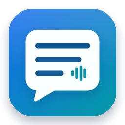
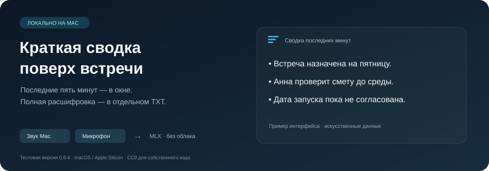

<p align="center"></p>
<h1 align="center">Meeting Summary · Сводка встречи</h1>
<p align="center">A rolling meeting summary above your other windows. Processed on your Mac.</p>
<p align="center"><strong>macOS 14.4+ · Apple Silicon · Test build 0.6.4 · CC0</strong></p>
<p align="center"><a href="README.md">Русский</a> · English</p>



A native macOS app that captures system audio, a microphone, or both, and shows a short summary of the last five minutes. The complete transcript is saved separately. No Bionic, LM Studio, cloud API or subscription is required at runtime.

**Early test version.** This snapshot corresponds to installed version 0.6.4, build 11. It is not ready for general distribution. Summaries can omit qualifications or misstate details. Cross-check dates, amounts and decisions against the original conversation.

## Features

- Independent system-audio and microphone capture, including a combined mode.
- System-audio capture while Mac speakers are muted; muting the source player itself can remove its audio.
- A rolling five-minute summary, with a separate full transcript.
- An almost transparent, text-only overlay; manual scrolling and one-shot arrival animation.
- Menu-bar controls, font size adjustment and source selection.
- Exclude your microphone from new app fragments without muting it in your call.
- Separate speech and summary workers; a disk-backed queue and recovery support.
- Source/display timestamps that distinguish a new summary from old text.

## Local pipeline

System audio / microphone → audio queue → Parakeet transcription → full TXT → five-minute context → Qwen summary → draft validation → overlay.

The current models are Parakeet TDT 0.6B v3 MLX 4-bit and Qwen3.5 9B MLX 4-bit, with thinking disabled. Draft checks are conservative guards, not a proof of semantic accuracy. A rejected draft leaves the previous summary visible.

## Test bundle

[0.6.4 test archive](dist/MeetingSummary-0.6.4-test.zip) · [SHA-256](dist/SHA256SUMS)

The archive contains the existing native app and its matching worker sources. **Python, dependencies and model weights are not bundled.** Manual runtime setup is required; this is not a one-click installer. The app is not Apple-notarized.

The tested development machine has Apple Silicon and 24 GB unified memory. A minimum supported memory configuration has not been established. See [setup](docs/SETUP.md), [bundle contents](dist/README.md), and [test limits](docs/TESTING.md). The application UI and setup guide are currently in Russian.

## Development

```sh
# Software-only checks: no models, capture or playback.
PYTHON=python3 /bin/sh scripts/check.sh

# Build without installing or starting audio capture.
MEETING_BUILD_ONLY=1 /bin/sh build.sh
```

Native shell: Swift, AppKit, Core Audio, AVFoundation. Workers: Python and MLX.

[Architecture](docs/ARCHITECTURE.md) · [Roadmap](ROADMAP.md) · [Contributing](CONTRIBUTING.md) · [Privacy](PRIVACY.md)

## License

Original project code, documentation and artwork are dedicated under **[CC0 1.0 Universal](LICENSE)**, with a waiver to the extent legally possible and a fallback license. Copy, modify and redistribute them, including commercially, without requesting permission.

Third-party libraries, models and materials retain their own terms: [THIRD_PARTY_NOTICES.md](THIRD_PARTY_NOTICES.md). No warranties are provided.
