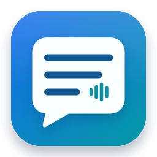
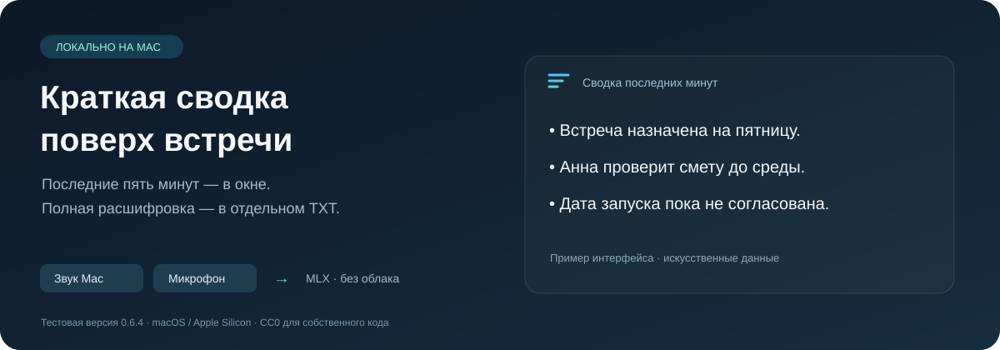

<h1 align="center">Сводка встречи · Meeting Summary</h1>

Локальная расшифровка, полная аудиозапись и краткий смысл разговора поверх остальных окон.

<strong>0.7.0 beta · macOS 14.4+ / Apple Silicon · Linux x86_64 · CC0</strong>

Русский · <a href="README.en.md">English</a>

Приложение записывает системный звук, микрофон или оба источника. Parakeet распознаёт речь; Qwen3.5 формирует короткую сводку последних пяти минут. Полный WAV и полный TXT сохраняются отдельно от этой сводки. Облачный API, подписка, Bionic и LM Studio не нужны.

**Статус: бета-кандидат.** Наличие исходников и сборки не означает завершённую проверку на чистом компьютере, 8 ГБ памяти или длительной реальной встрече. Linux-порт до успешного CI с настоящими CPU-моделями и проверки готового пакета считается непроверенным. Смысловая точность требует отдельной проверки; числа, условия, сроки и решения сверяются с TXT и аудио.

## Возможности

- Перемещаемое прозрачное окно и ручная прокрутка. На Mac управление находится в строке меню, на Linux — также в видимых кнопках и системном трее.
- Раздельные режимы системного звука, микрофона и совместной записи.
- Полная запись и расшифровка в одной папке дня: `Документы/Сводка встреч/YYYY-MM-DD`.
- Одинаковые имена пары: время начала, нейтральная тема разговора, уникальный ID. Пока тема не подтверждена, используется «Встреча».
- Время фраз в TXT и ссылка на соответствующее аудио. Временная разметка приблизительная, по распознавателю.
- Независимая обработка записи, распознавания и сводки; исходное аудио сохраняется и при ошибке распознавания.
- Проверка черновиков сводки по цитатам источника. Эта проверка уменьшает часть искажений, но не доказывает правильность каждого пересказа.

## macOS

Целевая система — macOS 14.4+ на Apple Silicon. Переносимый ZIP включает Python и зависимости; модели автоматически загружаются при первой подготовке, с закреплёнными ревизиями и SHA-256. Вручную устанавливать Python и pip получателю не требуется.

Основной профиль для 16 ГБ и выше — Qwen3.5-9B 4-bit и Parakeet 0.6B 4-bit через MLX. Профиль 4B для меньшей памяти экспериментален. Физический Mac с 8 ГБ не проверен: работоспособность, скорость и запас памяти для него не подтверждены.

Обычное распространение через Gatekeeper требует Developer ID Application и нотарификации Apple. Apple Development и ad-hoc подпись не дают такого статуса. До наличия проверенной подписи и результата нотарификации кандидат нельзя называть готовым доверенным установщиком.

Сборка и границы проверки: [packaging/README.md](packaging/README.md), [docs/SETUP.md](docs/SETUP.md).

## Linux

Первый целевой вариант — Ubuntu 24.04 и Debian 12/13 x86_64 с AVX2, PulseAudio либо PipeWire-Pulse. Основной графический сеанс — X11; поведение окна на Wayland зависит от композитора.

`.deb` и AppImage включают Python, Qt, sherpa-onnx, llama.cpp и аудиоинструменты. Parakeet v3 INT8 и Qwen3.5-9B Q4_K_M загружаются автоматически, около 6,84 ГБ. Рекомендуется 16 ГБ ОЗУ. Код, модели и настройки macOS не используются.

Описание, установка, источники и ограничения: [linux/README.md](linux/README.md). Workflow [Linux packages and real CPU inference](.github/workflows/linux-build.yml) проверяет виртуальные источники звука, CPU-модели на разрешённом синтетическом WAV и сохранённые пакеты. До фактического успешного прогона эти сценарии остаются непроверенными.

Windows отложен.

## Разработка и проверки

`PYTHON=python3 /bin/sh scripts/check.sh` запускает программные Python/Swift-проверки на macOS без открытия аудиоустройств и загрузки моделей. Linux-проверки описаны отдельно. Отчёты программных, синтетических и аппаратных проверок должны различаться: зелёный unit test не подтверждает качество целой реальной встречи.

[Архитектура](docs/ARCHITECTURE.md) · [Проверки](docs/TESTING.md) · [Приватность](PRIVACY.md) · [Сторонние компоненты](THIRD_PARTY_NOTICES.md) · [Изменения](CHANGELOG.md).

Собственный код, документация и графика — CC0 1.0, [LICENSE](LICENSE). Сторонние движки и модели сохраняют свои лицензии. Синтетический тестовый WAV разрешён для этого приватного комплекта; его публичное распространение под CC0 не заявляется.
